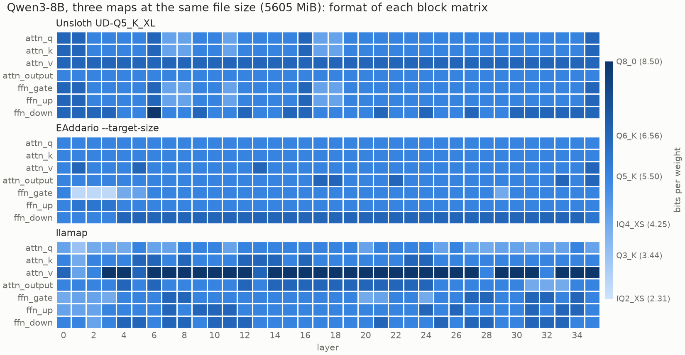

# llamap

Per-tensor precision maps for llama.cpp / GGUF quantization.

Given a Hugging Face model and a size budget, llamap measures how much each
weight matrix hurts the model output (KL divergence against BF16) when it alone
is quantized, in each format. It then picks one format per matrix to minimise
the total under the budget, and builds the GGUF with stock `llama-quantize
--tensor-type-file`.



## Usage

```
pip install -e .
export LLAMA_CPP_DIR=~/llama.cpp          # a built llama.cpp checkout

llamap map ~/models/Llama-3.1-8B-Instruct --like Q4_K_M --calib calib.txt
llamap map ~/models/Llama-3.1-8B-Instruct --like other-Q5.gguf --calib calib.txt --imatrix other.imatrix
```

`--method fisher` (default) estimates each cost as ½ E[(g·e)²] with 128 gradient
samples: linear in depth, ~15 min for the 11 formats of an 8B (RTX 5090, 16
CPU threads), most of it spent quantizing the candidates. `--method exact`
propagates each variant to the logits: quadratic in depth. Candidate matrices
are quantized in memory with ggml's own `ggml_quantize_chunk` and the imatrix,
byte-identical to `llama-quantize` (tested): no intermediate GGUF is written.
`--threads` sets the quantization / dequantization threads.

`--like` sets the budget: the bytes of the block matrices of a reference GGUF,
or of a llama-quantize preset. `token_embd` and `output` keep the reference's
types. Everything is cached in `work/<model>/`: changing the budget only
re-runs the solver and the build.

## Requirements

- **llama.cpp**, built with shared libraries (`BUILD_SHARED_LIBS=ON`, the
  default on Linux): llamap loads `build/bin/libggml-base.so` and calls
  `llama-quantize`, `llama-imatrix`, `llama-perplexity` and
  `convert_hf_to_gguf.py`. Tested on Linux (WSL2) only.
- **GPU**: the model is loaded in BF16 and each block is replayed in float32.
  Peak memory measured on Qwen3-8B is 26 GB (BF16 weights, `lm_head` in float32,
  gradient buffers), so an 8B needs a 32 GB GPU. Peak RAM fits in 24 GB.
- **Python** ≥ 3.10. Tested with Python 3.14, torch 2.14.1 (CUDA 13.0),
  transformers 5.20.2, gguf 0.19.0, numpy 2.5.4.
- **Architectures**: `llama` (Llama 3.x, SmolLM2) and `qwen3`, dense models
  only. Any other architecture stops with an explicit error.
- **For the benchmarks only**: `bench/perplexity` builds `llamap-perplexity`, a
  copy of `llama-perplexity` that parses special tokens in the text. It is
  linked against your llama.cpp build, which it does not modify:
  `cmake -S bench/perplexity -B bench/perplexity/build && cmake --build bench/perplexity/build`.

## Results

Three maps at the same file sizes, the sizes of Unsloth's Dynamic 2.0
`UD-Qn_K_XL` files:
- [Unsloth Dynamic 2.0](https://huggingface.co/unsloth), the published files;
- the `--target-size` mode of [llama.cpp PR #15550](https://github.com/ggml-org/llama.cpp/pull/15550)
  (EAddario), which estimates each tensor's error from its weights;
- llamap (Fisher, 128 samples).

EAddario and llamap use the same imatrix, and the sizes match within 0.2 MB.
`token_embd` and `output` are identical in all three, so only the block matrices differ.

KL divergence against BF16 (`llama-perplexity --kl-divergence`, 80 × 512 tokens
per text), averaged over 6 texts for Llama and 7 for Qwen3 (see
[Reproduce](#reproduce)). In brackets: the number of texts on which llamap is
better.

| Model | Budget | Unsloth | EAddario | llamap | vs Unsloth | vs EAddario |
|---|---|---|---|---|---|---|
| Llama 3.1 8B Instruct | Q2 (3232 MiB) | 0.2633 | 0.1804 | **0.1666** | −37 % (6/6) | −8 % (6/6) |
| | Q3 (4005 MiB) | 0.0886 | 0.0681 | **0.0653** | −26 % (6/6) | −4 % (5/6) |
| | Q4 (4763 MiB) | 0.0327 | 0.0283 | **0.0272** | −17 % (6/6) | −4 % (4/6) |
| | Q5 (5472 MiB) | 0.0110 | 0.0111 | **0.0096** | −13 % (6/6) | −14 % (6/6) |
| Qwen3-8B | Q2 (3340 MiB) | 0.1844 | 0.1227 | **0.1198** | −35 % (7/7) | −2 % (4/7) |
| | Q3 (4107 MiB) | 0.0640 | 0.0429 | **0.0392** | −39 % (7/7) | −9 % (6/7) |
| | Q4 (4898 MiB) | 0.0191 | 0.0170 | **0.0154** | −19 % (7/7) | −10 % (7/7) |
| | Q5 (5605 MiB) | 0.0075 | 0.0078 | **0.0058** | −22 % (7/7) | −25 % (7/7) |

- The gap with EAddario is largest at high precision (Q5). There, an error
  estimated from the weights ranks tensors poorly: on Llama, the last layers cost
  ~3× more in output KL for the same relative error. The image above shows the
  result: llamap spends its bits on `attn_v` at almost every depth.
- Inference speed is unchanged. llama-bench on CUDA gives the same pp512 within
  1 %, and tg128 at most 4 % lower (Q2, against Unsloth).
- Build time on an 8B: llamap takes ~15 min for the first budget (cost
  measurement), then ~1 min per extra budget. EAddario takes ~3 min, then
  ~1 min per extra budget.
- Limits: dense models only (no MoE yet); needs PyTorch, the HF weights and a
  GPU; two models tested.

## Validation

The predicted costs were checked against a ground truth: the measured ΔKL of each
tensor when it alone is degraded. Everything else is kept in Q8_0 with the
imatrix, one tensor goes to Q2_K, and the KL against BF16 is measured on 80 × 512
tokens of wikitext-2 test (bartowski's degrade-one protocol). `bench/truth_t.py`
computes it, with one `llama-quantize` and one `llama-perplexity` run per tensor
(~17 s per tensor for a 1.7B model on an RTX 5090), and `bench/validate_t.py`
compares the predictors with it.

Spearman correlation with the measured ΔKL, Q2_K, all block matrices:

| Predictor | Qwen3-1.7B (196 tensors) | SmolLM2-1.7B (168 tensors) |
|---|---|---|
| EAddario's error estimate (PR #15550, from his `llama-quantize`) | 0.45 | 0.44 |
| imatrix-weighted weight error, Σ imatrix_j Δw_ij² (our simple version) | −0.22 | 0.52 |
| error at the block output, ‖e‖² / ‖h‖² | 0.94 | 0.86 |
| KL at the model output, exact (`--method exact`) | 0.93 | 0.95 |
| KL at the model output, Fisher (`--method fisher`, 128 samples) | 0.93 | 0.95 |

- **EAddario's estimate** is his own per-tensor error, the one his solver
  minimizes, read from his `llama-quantize` log with every type but Q2_K
  excluded (see Reproduce), not a reimplementation. The imatrix-weighted weight
  error row is a simpler metric of ours, shown for reference.
- **Depth.** The error at the block output assumes that the same relative error
  costs the same at any depth. On SmolLM2, the ratio of measured ΔKL to this
  error grows with depth (correlation with the layer index 0.87). The output KL
  removes most of this bias (0.41). Within a role, the rank correlation on
  SmolLM2 goes from −0.45…+0.38 to +0.60…+0.88.
- **Calibration text.** The costs come from 512 tokens of calibration text. On
  Llama 3.1 8B, with the same imatrix, the costs were recomputed from four texts:
  the default wikitext-2 train excerpt, another wikitext-2 train excerpt, Python
  code (`argparse.py` from the standard library) and UltraChat `train_sft`
  conversations as plain `User:` / `Assistant:` text. Spearman correlation of the
  costs within a format: 0.88 between the two wikitext excerpts, 0.87 between
  wikitext and code, 0.58 between wikitext and chat. Mean KL of the maps on the
  five evaluation texts (test, book, code, chat, chat template):

  | Calibration | Q2 | Q3 | Q4 | Q5 |
  |---|---|---|---|---|
  | wikitext (default) | 0.178 | 0.0707 | 0.0298 | 0.0105 |
  | wikitext, other excerpt | 0.181 | 0.0710 | 0.0294 | 0.0103 |
  | Python code | 0.181 | 0.0721 | 0.0284 | 0.0101 |
  | UltraChat, plain text | 0.215 | 0.0935 | 0.0378 | 0.0146 |
  | *EAddario, for reference* | *0.190* | *0.0735* | *0.0309* | *0.0121* |

  Prose and code give maps of the same quality: many tensors change format
  between them, but no more than between two wikitext excerpts, so these are
  near-ties. The chat calibration gives worse maps on every text, chat included,
  and loses to EAddario at every budget. Use prose or code to calibrate.
  (`bench/calib_t.py`)
- **Fisher vs exact.** On Llama 3.1 8B, the 11 formats (2 464 tensor × format
  pairs) give a Spearman correlation of 0.998 with 128 samples. With 32 samples,
  the noise changes enough choices at the margin to visibly degrade the Q5 map:
  128 is the default.
- **Additivity.** The solver assumes that costs add up. On Llama 3.1 8B, the
  output KL measured with all the matrices of a map quantized at once, divided
  by the sum of the individual costs, is 1.01 for the Q3 and Q4 maps, 0.96 to
  1.14 for Q5 maps, and 1.24 for the Q2 map (1.09 to 1.31 for random Q2-level
  maps). The predicted order of the Q5 maps is the measured order.
  (`bench/additivity_t.py`)

## Reproduce

Models and files:

| | Llama 3.1 8B | Qwen3-8B |
|---|---|---|
| HF weights | `unsloth/Llama-3.1-8B-Instruct` @ `4699cc75b550` | `Qwen/Qwen3-8B` @ `b968826d9c46` |
| Unsloth GGUF | `unsloth/Llama-3.1-8B-Instruct-GGUF` @ `600b0020115f` | `unsloth/Qwen3-8B-GGUF` @ `a6adef130ffb` |

- llama.cpp `caa8191df159` (2026-10-26). EAddario: branch `quantize` of PR
  #15550, commit `145d435eb613`.
- **imatrix** (shared by EAddario and llamap): `llama-imatrix -m bf16.gguf -f
  wiki.train.raw -c 512 --chunks 200`, on wikitext-2-raw train.
- **llamap calibration**: the first 512 tokens of a 4 kB excerpt of
  wikitext-2-raw train, characters 395 211 to 399 209 of `wiki.train.raw`.
- **Evaluation texts**, all disjoint from the calibration data:
  - `test`, `valid`: wikitext-2-raw test and validation;
  - `book`: Moby Dick, Project Gutenberg #2701, full text;
  - `code`: the concatenation of llama.cpp's `src/*.cpp` at the commit above;
  - `chat`: UltraChat 200k (`test_sft`), ~400 k characters as plain
    `User:` / `Assistant:` text;
  - `chat_template`: the same conversations, with the model's chat template;
  - `chat_thinking` (Qwen3 only): 48 Qwen3-8B BF16 thinking traces on UltraChat
    `test_sft` prompts.

  Stock `llama-perplexity` tokenizes the template's special tags (`<|im_start|>`,
  `<|eot_id|>`...) as plain text, and has no option to change that. The BF16
  logits of `chat_template` are therefore computed with `bench/perplexity`, the
  same tool rebuilt with special-token parsing (see below).

Commands, for each budget `Qn`:

```
# EAddario (PR #15550 build)
llama-quantize --imatrix X.imatrix.gguf --target-size $(stat -c %s X-UD-Qn_K_XL.gguf) \
    --state-file X.state X-bf16.gguf X-eaddario-Qn.gguf
# llamap, at the same budget
llamap map <hf_dir> --like X-eaddario-Qn.gguf --calib calib.txt --imatrix X.imatrix.gguf --threads 16
# KL against BF16, mean / percentiles / same top-1 / |ΔPPL|
python bench/eval_kl_t.py --bf16 X-bf16.gguf --texts wiki.test.raw,wiki.valid.raw,book.txt,code.txt,chat.txt \
    --special-texts chat_template.txt --out results.csv unsloth=X-UD-Qn_K_XL.gguf eaddario=X-eaddario-Qn.gguf llamap=work/X/llamap-X-eaddario-Qn-fisher.gguf
# validation (Qwen3-1.7B, SmolLM2-1.7B), Q2_K: ground truth, costs, EAddario's estimates, Spearman
python bench/truth_t.py --bf16 X-bf16.gguf --imatrix X.imatrix.gguf --text wiki.test.raw --out truth-q2_k.csv
llamap costs <hf_dir> --calib calib.txt --imatrix X.imatrix.gguf --formats q2_k --method exact --work work/X
llamap costs <hf_dir> --calib calib.txt --imatrix X.imatrix.gguf --formats q2_k --method fisher --work work/X
llama-quantize --imatrix X.imatrix.gguf --target-bpw 3 --target-exclude \
    iq1_s,iq1_m,iq2_xxs,iq2_xs,iq2_s,iq3_xxs,iq3_s,iq4_xs,iq4_nl,q3_k,q4_0,q4_1,q4_k,q5_0,q5_1,q5_k,q6_k,q8_0,f16,bf16 \
    X-bf16.gguf ea.gguf > eaddario-q2_k.log 2>&1   # PR #15550 build
python bench/validate_t.py --truth truth-q2_k.csv --costs exact=work/X/costs-exact.csv \
    --costs fisher=work/X/costs-fisher.csv --eaddario-log eaddario-q2_k.log --bf16 X-bf16.gguf --imatrix X.imatrix.gguf
# calibration text: one work directory per --calib, then costs and maps compared
python bench/calib_t.py wiki=work/X wiki2=work/X-wiki2 chat=work/X-chat code=work/X-code
# the image
python bench/plot_maps_t.py --out maps.png unsloth=X-UD-Q5_K_XL.gguf eaddario=X-eaddario-Q5.gguf \
    llamap=work/X/map-X-eaddario-Q5-fisher.tensor-types.txt
```

## Related work and credits

- **bartowski**, *Per-tensor layout maps for GGUF quantization* (Hugging Face
  blog, September 2026). It measures each tensor's sensitivity with degrade-one
  runs and turns it into a `--tensor-type-file` with a solver. llamap uses the
  same output and the same protocol as ground truth. Its contribution is to
  predict these costs for every format in one pass, instead of one
  `llama-perplexity` run per tensor and format.
- **EAddario**, `--target-bpw` / `--target-size` in
  [llama.cpp PR #15550](https://github.com/ggml-org/llama.cpp/pull/15550):
  per-tensor types under a budget, from his own imatrix-based error estimate per tensor and type.
- **Unsloth**, [Dynamic 2.0 GGUFs](https://huggingface.co/unsloth): per-layer
  type choices, and the published files used as the reference sizes.
- **llama.cpp**: the k-quants, the IQ formats and the imatrix (ikawrakow), and
  `llama-perplexity --kl-divergence`.
- **Second-order sensitivity.** Using the Hessian or the Fisher information to
  rank layers for mixed precision is not new. See HAWQ (Dong et al., ICCV 2019,
  [arXiv:1905.03696](https://arxiv.org/abs/1905.03696)) and HAWQ-V2 (NeurIPS
  2020, [arXiv:1911.03852](https://arxiv.org/abs/1911.03852)), and, for LLMs,
  SqueezeLLM (Kim et al., ICML 2024,
  [arXiv:2306.07629](https://arxiv.org/abs/2306.07629)). llamap applies the idea
  to the error at each block output for the GGUF formats, and checks it against
  measured KL.

## Layout

| file | role |
|---|---|
| `llamap/pipeline.py` | the chain: prepare, costs, budget, solve, build |
| `llamap/predict.py` | cost of each matrix: KL at the output with only that matrix quantized |
| `llamap/hf_gguf.py` | HF ↔ GGUF names, q/k row permutation, supported architectures |
| `llamap/solver.py` | multiple-choice knapsack (Lagrangian relaxation + greedy fill) |
| `llamap/build.py` | `--tensor-type-file`, llama-quantize, checks |
| `llamap/quantize.py` | imatrix loading, in-memory quantization of each format |
| `llamap/ggml.py` | ctypes bindings to libggml-base (quantize, dequantize) |
| `llamap/llamacpp.py` | calls to the llama.cpp tools |
| `llamap/cli.py` | command line |
| `tests/*_t.py` | unit tests (`pytest`) |
| `bench/truth_t.py`, `bench/validate_t.py` | degrade-one ground truth, predictors against it |
| `bench/calib_t.py` | stability of the costs and maps across calibration texts |
| `bench/perplexity/` | `llama-perplexity` rebuilt with special-token parsing |
| `bench/*_t.py` | other measurements: KL against BF16, Fisher vs exact costs, additivity, map heatmaps |

Convention: every test or measurement file ends in `_t`.
